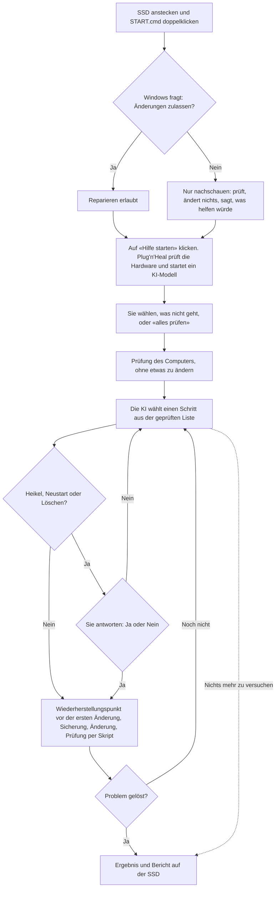

# Plug'n'Heal

**Eine kostenlose Hilfe-SSD für Windows: anstecken, auf einen Knopf klicken, und eine KI auf der SSD behebt
häufige Probleme. Ohne Internet.**

[English](README.md) | Deutsch

[](https://github.com/MisterDeeds/plug-n-heal/actions/workflows/ci.yml)
[](LICENSE)

> [!IMPORTANT]
> **Stand: Version 0.1, noch früh.** Der Programmcode wird automatisch getestet (Pester, auf Linux und Windows,
> mit Windows PowerShell 5.1 und PowerShell 7). Die Reparaturschritte sind mit dem PowerShell-Parser und mit
> Tests geprüft, aber **noch nicht auf echten Heim-PCs ausprobiert** (siehe
> [docs/TOOLBOX.md](docs/TOOLBOX.md#11-what-still-needs-real-windows), englisch). Probieren Sie es zuerst an
> einem Computer aus, an dem nicht viel hängt, und
> [erzählen Sie uns, wie es lief](https://github.com/MisterDeeds/plug-n-heal/issues/new/choose).

> [!CAUTION]
> **Dieses Programm verändert Ihren Computer.** Eine künstliche Intelligenz (KI) wählt Reparaturschritte aus,
> und diese laufen mit Administratorrechten. Eine KI kann sich irren. Plug'n'Heal benutzt deshalb nur Schritte
> aus einer festen, geprüften Liste, sichert vor jeder Änderung, prüft das Ergebnis mit einem Skript und fragt
> Sie vor allem, was heikel ist. Sichern Sie trotzdem vorher Ihre Fotos und Dokumente. Benutzen Sie es nicht an
> einem Computer Ihrer Firma oder Schule.

## Inhalt

- [Was es tut](#was-es-tut) · [So läuft es ab](#so-läuft-es-ab) · [Was Sie brauchen](#was-sie-brauchen)
- [Die Plug'n'Heal-SSD erstellen](#die-plugnheal-ssd-erstellen) · [Benutzen](#benutzen)
- [Welches KI-Modell nimmt mein Computer?](#welches-ki-modell-nimmt-mein-computer)
- [Sicherheit: was es nie tut](#sicherheit-was-es-nie-tut) · [Was schiefgehen kann](#was-schiefgehen-kann) ·
  [Datenschutz](#datenschutz)
- [Wenn es nicht startet](#wenn-es-nicht-startet) · [Häufige Fragen](#häufige-fragen) ·
  [Für Entwickler](#für-entwickler)
- [Lizenzen](#lizenzen) · [Haftung](#haftung) · [Dank](#dank)

## Was es tut

- **Es schaut zuerst nach.** Eine feste Prüfung liest den Zustand des Computers: Internet, freier Speicher,
  Drucker, Ton, Windows Update, wichtige Einstellungen und die Ereignisanzeige. Diese Prüfung verändert nichts.
- **Eine KI auf der SSD wählt die Reparatur.** Ein Sprachmodell läuft mit [Ollama](https://ollama.com) direkt
  von der SSD. Es darf nur aus einer Liste von 92 geprüften Aktionen wählen (61 davon verändern etwas). Eine
  freie Befehlszeile bekommt es nicht, ausser einer gefilterten für die grössten Modelle
  ([Einzelheiten](docs/SAFETY.md), englisch).
- **Jede Änderung wird gesichert und geprüft.** Vor der ersten Änderung versucht es, einen
  Wiederherstellungspunkt von Windows anzulegen. Vor jeder Änderung sichert es den alten Zustand. Nach jeder
  Änderung prüft ein Skript, nicht die KI, ob es geklappt hat.
- **Es fragt Sie vorher**, bevor es etwas Heikles macht, bevor der Computer neu starten muss und bevor es etwas
  löscht (es löscht nur temporäre Dateien und Zwischenspeicher, oder ein gespeichertes WLAN, nachdem es eine Kopie
  davon behalten hat).
- **Es arbeitet ohne Internet und behält alles auf der SSD.** Es sendet nichts. Ein kurzer Bericht und ein
  ausführliches Protokoll landen auf der SSD.

## So läuft es ab



Ein Durchgang endet, wenn die Prüfung bestanden ist, wenn die KI sagt, sie sei fertig, nach 12 Runden, nach
mehreren Fehlern hintereinander oder wenn ein Befund sagt, dass Reparieren hier falsch wäre (zum Beispiel, wenn
eine Firma den Computer absichtlich vom Netz getrennt hat). «Gelöst» erscheint nur, wenn das Prüfskript bestanden
ist.

## Was Sie brauchen

| Wofür | Was Sie brauchen |
|---|---|
| Der Computer mit dem Problem | Windows 10 oder Windows 11, 64 Bit, mit Intel- oder AMD-Prozessor. Mindestens 8 GB Arbeitsspeicher (RAM), besser 16 GB. Ein USB-3-Anschluss ist schneller. Windows auf ARM (zum Beispiel Notebooks mit Snapdragon) ist nicht getestet. |
| Die SSD | Eine externe SSD, formatiert mit **exFAT**. Empfohlen sind 64 GB oder mehr. Ein schneller USB-Stick geht auch, lädt die KI aber langsamer. |
| Zum Erstellen der SSD (einmal) | Irgendein PC mit Internet: Windows 10 oder 11 (mit Assistent), oder Linux oder macOS (Befehlszeile). |

So viel Platz braucht jede Auswahl (die Modellgrössen sind gemessen, siehe [docs/MODELS.md](docs/MODELS.md),
englisch):

| Auswahl im Assistenten | KI-Modelle | Gesamt auf der SSD (zeigt der Assistent) | Grösse der SSD | Download |
|---|---|---|---|---|
| Klein | 2 kleine Modelle, 5,3 GB | etwa 8,1 GB | ab 16 GB | etwa 6,9 GB |
| **Standard** (empfohlen) | 4 Modelle, 29,6 GB | etwa 32,4 GB | ab 64 GB | etwa 31,2 GB |
| Vollständig | 6 Modelle, 62,6 GB | etwa 65,4 GB | ab 128 GB | etwa 64,2 GB |

«Gesamt auf der SSD» heisst: Modelle + das Programm Ollama (entpackt 2,3 GB) + 0,5 GB, die der Assistent frei
lässt.

## Die Plug'n'Heal-SSD erstellen

Das machen Sie einmal, an einem PC mit Internet. Die Dateien, die schon auf der SSD sind, bleiben erhalten: Der
Assistent schreibt nur den Ordner `PlugNHeal`, die Datei `START.cmd` und die Datei `README.txt`. Er formatiert
nie ein Laufwerk.

### Unter Windows

1. **SSD anstecken.** Sie muss mit exFAT (oder NTFS) formatiert sein. Neue SSDs sind das oft. Wenn nicht, lesen
   Sie [SSD mit exFAT formatieren](#ssd-mit-exfat-formatieren). Beim Formatieren wird alles auf der SSD gelöscht.
2. **Plug'n'Heal herunterladen.** Öffnen Sie <https://github.com/MisterDeeds/plug-n-heal>, klicken Sie auf den
   grünen Knopf **Code** und dann auf **Download ZIP**. Fertige Versionen zum Herunterladen gibt es noch nicht.
3. **Die ZIP-Datei freigeben.** Klicken Sie mit der rechten Maustaste auf die heruntergeladene ZIP-Datei und
   wählen Sie **Eigenschaften**. Setzen Sie unten das Häkchen bei **Zulassen** und klicken Sie auf **OK**. Gibt es
   dieses Häkchen nicht, machen Sie einfach weiter.
   *Warum:* Windows markiert heruntergeladene Dateien. Ohne diesen Schritt trägt jede entpackte Datei die Markierung,
   und Windows zeigt Sicherheitswarnungen oder blockiert den Assistenten (mit der intelligenten App-Steuerung,
   «Smart App Control»).
4. **Entpacken.** Rechte Maustaste auf die ZIP-Datei, **Alle extrahieren...**, dann **Extrahieren**. Ein Ordner
   geht auf.
5. **Den Assistenten starten.** Doppelklicken Sie in diesem Ordner auf **BUILD.cmd**. Ein schwarzes Fenster und der
   Assistent «Plug'n'Heal – SSD vorbereiten» gehen auf. Lassen Sie das schwarze Fenster offen.
6. **Die SSD wählen.** Klicken Sie unter «1. Welche SSD soll vorbereitet werden?» auf Ihre SSD und dann auf
   **Weiter**. Fehlt sie in der Liste? Klicken Sie auf **Liste aktualisieren**, oder auf **Alle Laufwerke
   anzeigen** für Laufwerke, die Windows als eingebaut zählt.
7. **Die Grösse wählen.** Wählen Sie unter «2. Wie viel soll auf die SSD?» **Standard**, ausser Ihre SSD ist klein.
   Klicken Sie dann auf **SSD erstellen**.
8. **Warten.** Der Assistent lädt das Programm Ollama und die KI-Modelle herunter, prüft jede Datei und schreibt
   sie auf die SSD. Mit 100 Mbit/s Internet dauert *Standard* ungefähr 45 Minuten, *Vollständig* etwa 1,5 Stunden.
   Lassen Sie den PC eingeschaltet und am Internet; der Assistent verhindert den Ruhezustand. Sie können jederzeit
   abbrechen. Starten Sie `BUILD.cmd` später noch einmal, dann geht es dort weiter, wo es aufgehört hat.
9. **Fertig.** Wenn «Fertig! Die SSD ist bereit.» erscheint, werfen Sie die SSD im Explorer aus (rechte
   Maustaste, **Auswerfen**) und ziehen Sie sie ab.

### SSD mit exFAT formatieren

**Achtung: Dabei wird ALLES auf der SSD gelöscht.** Sichern Sie wichtige Dateien vorher anderswo.

1. Im Explorer mit der rechten Maustaste auf die SSD klicken und **Formatieren...** wählen.
2. Dateisystem: **exFAT**. Volumebezeichnung: **PLUGNHEAL**. **Schnellformatierung** angehakt lassen.
3. **Starten** klicken und bestätigen.

Auf dem Mac und unter Linux: siehe [docs/BUILDING.md](docs/BUILDING.md#2-format-the-ssd-with-exfat) (englisch).

### Unter Linux oder macOS

Sie brauchen `bash`, `curl` und `python3` (auf dem Mac: `xcode-select --install`). Hängen Sie die SSD (exFAT) ein
und geben Sie ein:

```bash
git clone https://github.com/MisterDeeds/plug-n-heal.git
cd plug-n-heal
./builder/build-drive.sh /media/$USER/PLUGNHEAL standard   # Linux, Pfad anpassen
./builder/build-drive.sh /Volumes/PLUGNHEAL standard       # macOS
```

Statt `standard` geht auch `small` (klein) oder `full` (vollständig). Nach einem Abbruch denselben Befehl noch
einmal eingeben. Das Skript lädt die Modelle direkt von Ollama und prüft jede Datei mit SHA-256. Auf dem Mac ist
es noch nicht getestet. Mehr dazu: [docs/BUILDING.md](docs/BUILDING.md) (englisch).

## Benutzen

Dieser Teil ist für die Person, die am Computer mit dem Problem sitzt.

1. **Speichern Sie Ihre Arbeit und schliessen Sie Ihre Programme.** Manche Reparaturen brauchen einen Neustart.
2. **Stecken Sie die SSD am Computer an.**
3. **Öffnen Sie die SSD.** Öffnen Sie den Explorer (das Ordner-Symbol in der Taskleiste, oder gleichzeitig die
   Windows-Taste und E drücken). Klicken Sie links auf die SSD. Sie heisst oft *PLUGNHEAL*.
4. **Doppelklicken Sie auf `START.cmd`.** Windows zeigt die Datei vielleicht nur als *START* an. Kurz erscheint ein
   kleines schwarzes Fenster.
5. **Windows fragt:** «Möchten Sie zulassen, dass durch diese App Änderungen an Ihrem Gerät vorgenommen werden?»
   (Windows PowerShell, Herausgeber Microsoft Windows). Klicken Sie auf **Ja**.
   Klicken Sie auf **Nein**, dann schaut Plug'n'Heal nur nach. Es ändert nichts und sagt Ihnen am Schluss, was
   wahrscheinlich helfen würde.
6. **Klicken Sie auf den grossen Knopf «Hilfe starten».** Warten Sie 1 bis 2 Minuten, bis es bereit ist. Sie
   müssen dabei nichts tun.
7. **«Was funktioniert nicht?»** Klicken Sie auf das, was am besten passt: das Internet, ein langsamer Computer,
   ein voller Speicher, der Drucker, der Ton, Windows-Updates, der Bildschirm. Nicht sicher? Klicken Sie auf
   **«Ich weiss es nicht – bitte alles prüfen»**. Für alles andere klicken Sie auf **«Etwas anderes»** und
   schreiben einen Satz, zum Beispiel «Der Bildschirm ist sehr dunkel.»
8. **Beantworten Sie die Fragen.** Vor einem wichtigen Schritt fragt ein Fenster «Darf ich das machen?» und
   erklärt, worum es geht. Klicken Sie auf **«Ja, machen»** oder **«Nein»**. Wenn Sie unsicher sind, klicken Sie
   auf **Nein**. Ein «Nein» gilt: Derselbe Schritt wird nicht noch einmal versucht.
9. **Lesen Sie das Ergebnis.** Dort steht «Geschafft! Das Problem ist behoben.» oder «Ich konnte das Problem
   leider nicht ganz lösen.», dazu die Liste, was gemacht wurde. **«Bericht anzeigen»** öffnet den Bericht. Wenn
   es dort steht, starten Sie den Computer neu.
10. **Klicken Sie auf «Fertig»** und ziehen Sie dann die SSD ab.

Sie können jederzeit mit **Abbrechen** aufhören. Was schon erledigt ist, bleibt so.

Der Bericht (`summary.txt`) und das ausführliche Protokoll liegen auf der SSD im Ordner
`PlugNHeal\logs\<Computername>-<Datum und Uhrzeit>\`. Ist das Problem nicht gelöst, zeigen Sie diesen Bericht einer
Person, die sich mit Computern auskennt.

## Welches KI-Modell nimmt mein Computer?

Plug'n'Heal wählt selbst. Es misst den Speicher der Grafikkarte (VRAM) und den Arbeitsspeicher (RAM), nimmt das
grösste Modell auf der SSD, das passt, lädt es und misst, wie schnell es ist. Schafft es weniger als 5 Token pro
Sekunde, versucht es das nächstkleinere Modell.

| Ihr Computer | Modell, das es nimmt (wenn es auf der SSD ist) | Auf der SSD bei |
|---|---|---|
| Grafikkarte von NVIDIA oder AMD mit 24 GB oder mehr | Qwen3.8 27B, auf der Grafikkarte | Standard, Vollständig |
| NVIDIA- oder AMD-Karte mit 16 oder 20 GB und 32 GB RAM | Qwen3.6 35B-A3B (schnelle Variante), teils auf dem Prozessor | Vollständig |
| NVIDIA- oder AMD-Karte mit 16 oder 20 GB, weniger RAM | Qwen3.5 9B in höherer Genauigkeit (Q8) | Vollständig |
| NVIDIA- oder AMD-Karte mit 10 bis 12 GB (oder 16 bis 20 GB bei *Standard*) | Qwen3.5 9B | Standard, Vollständig |
| NVIDIA- oder AMD-Karte mit 6 oder 8 GB | Qwen3.5 4B | allen |
| NVIDIA- oder AMD-Karte mit 4 oder 5 GB | Qwen3.5 2B | allen |
| Keine passende Karte (Intel- oder eingebaute Grafik, oder eine Karte unter 4 GB), 12 GB RAM oder mehr | Qwen3.5 4B, auf dem Prozessor | allen |
| Keine passende Karte, 8 GB RAM | Qwen3.5 2B, auf dem Prozessor | allen |
| Weniger als 8 GB RAM | trotzdem Qwen3.5 2B, wahrscheinlich zu langsam | allen |

Die genaue Regel steht in [docs/MODELS.md](docs/MODELS.md) (englisch). Kleine Modelle sind weniger zuverlässig
als grosse. Nur die zwei grössten Modelle dürfen eigene (gefilterte) PowerShell-Befehle vorschlagen; die anderen
können nur die geprüfte Liste benutzen.

## Sicherheit: was es nie tut

- Ihre persönlichen Dateien löschen. Die einzigen Schritte, die löschen, entfernen alte temporäre Dateien und
  Zwischenspeicher oder vergessen ein gespeichertes WLAN, nachdem sie eine Kopie davon gesichert haben. Sie fragen
  immer vorher. Absturzberichte und hängende Druckaufträge werden auf die SSD verschoben, nicht gelöscht.
- Eine Festplatte formatieren, aufteilen oder löschen, oder die Startkonfiguration ändern.
- Microsoft Defender, die Firewall, SmartScreen, die Benutzerkontensteuerung oder BitLocker ausschalten oder
  schwächen.
- Eine Netzwerksperre aufheben, die eine Firma mit Defender for Endpoint gesetzt hat. Es erklärt die Sperre und
  hört auf.
- BitLocker-Wiederherstellungsschlüssel auslesen oder Passwörter anzeigen.
- Wiederherstellungspunkte oder Schattenkopien löschen.
- Benutzerkonten oder Passwörter anlegen, ändern oder löschen.
- Sich selbst auf dem Computer installieren. Kein Schritt der Liste installiert Programme oder Treiber.
- Etwas ins Internet senden. Die KI läuft auf der SSD und ist nur vom Computer selbst aus erreichbar (127.0.0.1).
- Einen Befehl von seiner Sperrliste ausführen, auch wenn Sie «Ja» sagen.

Wie es entscheidet, wann es fragt und wo seine Grenzen sind: [docs/SAFETY.md](docs/SAFETY.md) (englisch).

## Was schiefgehen kann

| Was passieren kann | Was Plug'n'Heal dagegen tut | Was Sie tun können |
|---|---|---|
| Die KI erkennt das Problem falsch, die Reparatur hilft nicht | Nur geprüfte Schritte; ob es geklappt hat, prüft ein Skript; «gelöst» nur, wenn die Prüfung besteht | Den Bericht einer Person zeigen, die sich auskennt |
| Die KI schreibt während der Arbeit etwas Falsches (kleine Modelle behaupten manchmal Dinge, die sie nicht getan haben) | Ihre Zwischenmeldungen sind als «noch nicht geprüft» markiert; das Ergebnis entsteht nur aus geprüften Resultaten | Dem Ergebnis glauben, nicht den Zwischenmeldungen |
| Eine Reparatur hat auf Ihrem Computer eine Nebenwirkung | Sicherung vor jeder Änderung; Rücknahme, wenn die Änderung scheitert; Wiederherstellungspunkt vor der ersten Änderung | [Systemwiederherstellung](#wenn-es-schlimmer-wurde-systemwiederherstellung) |
| Es entsteht kein Wiederherstellungspunkt (Computerschutz aus, Windows erlaubt nur einen pro 24 Stunden, ...) | Schreibt es ins Protokoll und macht weiter; jeder Schritt hat seine eigene Sicherung | Vorher den Computerschutz einschalten, wenn Sie einen frischen Punkt wollen |
| Die Schritte verhalten sich auf Ihrem Computer anders als in den Tests | Sie sind noch nicht auf vielen echten Computern gelaufen | Zuerst an einem weniger wichtigen Computer ausprobieren; Probleme melden |
| Firmen- oder Schulcomputer, Smart App Control oder S-Modus sperren es | Eine gesperrte PowerShell wird erkannt und erklärt; auf verwalteten Computern bleiben Netzwerk, Updates und Uhrzeit unangetastet | Die Person fragen, die den Computer betreut |
| Die Firma hat den Computer mit Defender for Endpoint vom Netz getrennt | Erkannt, erklärt, nichts geändert; das lässt sich am Computer selbst nicht aufheben | Die Informatik der Firma anrufen |
| Es ist sehr langsam oder sagt, der Computer sei zu langsam | Nimmt ein kleineres Modell; misst das Tempo | Einen anderen Computer nehmen, ein Notebook ans Netzteil hängen |
| Ein Virenschutz warnt | Einfache, lesbare Skripte; kein versteckter Code | Den Virenschutz nicht ausschalten; [melden](https://github.com/MisterDeeds/plug-n-heal/issues) |
| Persönliche Angaben landen im Protokoll | Alles bleibt auf der SSD | Den Ordner `logs` löschen, bevor Sie die SSD weitergeben |

### Wenn es schlimmer wurde: Systemwiederherstellung

Wenn Windows einen Wiederherstellungspunkt anlegen konnte, können Sie dorthin zurück: Drücken Sie die
Windows-Taste, tippen Sie **Wiederherstellungspunkt erstellen**, öffnen Sie es, klicken Sie auf
**Systemwiederherstellung...** und wählen Sie den Punkt mit dem Namen «Plug'n'Heal: ...». Fotos und Dokumente
bleiben dabei unberührt. Anleitung von Microsoft:
[Verwenden der Systemwiederherstellung](https://support.microsoft.com/de-de/windows/verwenden-der-systemwiederherstellung-a5ae3ed9-07c4-fd56-45ee-096777ecd14e).

Jede Änderung ist ausserdem im Ordner des Durchgangs auf der SSD gesichert (`backups\`). Einen einzelnen Schritt
von dort zurückzunehmen ist etwas für Fachleute (`Undo-PnhAction`, siehe [docs/TOOLBOX.md](docs/TOOLBOX.md));
einen Knopf dafür gibt es noch nicht.

## Datenschutz

- Plug'n'Heal arbeitet ohne Internet. Es sendet nichts, und das KI-Modell läuft auf der SSD.
- Jeder Durchgang legt auf der SSD einen Ordner an: `PlugNHeal\logs\<Computername>-<Datum und Uhrzeit>\`. Darin
  liegen der Bericht, die ganze Prüfung des Computers, das Gespräch mit der KI und die Sicherungen. Auch der
  Assistent legt sein Protokoll dort ab.
- Diese Dateien enthalten Angaben zum Computer: seinen Namen, Druckernamen, Netzwerkeinstellungen, Meldungen aus
  der Ereignisanzeige, Benutzernamen in Ordnerpfaden und Ihre eigenen Worte. Passwörter sammelt Plug'n'Heal nicht
  absichtlich, aber manche Ausgaben können persönliche Angaben enthalten.
- **Bevor Sie die SSD jemand anderem geben, löschen Sie den Ordner `PlugNHeal\logs`.** (Danach sind auch die
  Sicherungen weg.)

## Wenn es nicht startet

| Was Sie sehen | Was es heisst | Was Sie tun können |
|---|---|---|
| «Plug'n'Heal konnte nicht starten ... wahrscheinlich gesperrt» mit einem Code | Windows hat PowerShell nicht laufen lassen, meist auf einem Firmen- oder Schulcomputer | Die Person fragen, die den Computer betreut |
| «Hier darf der Helfer nicht laufen» | PowerShell läuft in einem gesperrten Modus (Firmenregeln, vielleicht Smart App Control) | Wie oben. Dort kann Plug'n'Heal nicht arbeiten |
| Es passiert gar nichts, oder Windows sagt, diese App lasse sich nicht ausführen | Windows im S-Modus erlaubt nur Apps aus dem Store | Im S-Modus läuft Plug'n'Heal nicht |
| «Plug'n'Heal ist unvollstaendig: Der Ordner PlugNHeal fehlt» | Die SSD wurde nicht erstellt, oder Dateien wurden gelöscht | Den Assistenten noch einmal laufen lassen |
| «Ohne Ihre Erlaubnis kann ich nur nachschauen» | Sie haben bei der Frage von Windows **Nein** geklickt | Neu starten und **Ja** klicken. Ein Standardbenutzer braucht dafür ein Administrator-Passwort |
| «Der Helfer liess sich nicht starten» | Das Programm Ollama auf der SSD ist nicht angesprungen | Einen anderen USB-Anschluss versuchen. Fehlen Dateien (zum Beispiel vom Virenschutz entfernt), den Ordner `PlugNHeal\runtime` auf der SSD löschen und den Assistenten noch einmal laufen lassen |
| «Auf dem Laufwerk fehlt der Helfer» | Kein KI-Modell auf der SSD | Den Assistenten noch einmal laufen lassen |
| «Dieser Computer ist leider zu langsam» | Selbst das kleinste Modell auf der SSD schaffte keine 5 Token pro Sekunde | Andere Programme schliessen, ein Notebook ans Netzteil hängen, oder einen anderen Computer nehmen |
| «Plug'n'Heal ist schon offen» | Zweimal gestartet | Das Fenster unten in der Taskleiste suchen |
| Der Assistent meldet «Diese SSD ist mit FAT32 formatiert» | Auf FAT32 passen keine Dateien über 4 GB | [SSD mit exFAT formatieren](#ssd-mit-exfat-formatieren) |
| Der Assistent meldet «Auf der SSD ist zu wenig Platz» | Die Auswahl passt nicht | Eine kleinere Auswahl oder eine grössere SSD nehmen |
| Der Assistent hat aufgehört (Internet weg, Ruhezustand, Abbruch) | Das schon Heruntergeladene bleibt erhalten | Den Assistenten noch einmal starten; er macht weiter |
| «Die Grösse von ... passt nicht zur Modellliste» | Ein Modell wurde auf dem Server von Ollama verändert | Eine neuere Version von Plug'n'Heal verwenden |

Wenn Sie um Hilfe bitten, legen Sie `summary.txt` und `run.log` aus dem Ordner des Durchgangs bei (vorher
persönliche Angaben entfernen).

## Häufige Fragen

**Braucht es Internet?** Nein. Nur das Erstellen der SSD braucht Internet.

**Installiert es etwas auf meinem Computer?** Nein. Es läuft von der SSD und behält seine Dateien dort. Die
Reparaturen selbst ändern Einstellungen von Windows, und Windows legt vielleicht einen Wiederherstellungspunkt an.

**Schickt es meine Daten irgendwohin?** Nein. Siehe [Datenschutz](#datenschutz).

**Wie lange dauert es?** Das Vorbereiten dauert 1 bis 2 Minuten. Eine Reparatur dauert meist einige Minuten; auf
einem langsamen Computer ohne Grafikkarte kann jeder Schritt länger dauern.

**Kann ich eine SSD an vielen Computern benutzen?** Ja. Jeder Durchgang bekommt einen eigenen Ordner mit dem Namen
des Computers.

**Darf ich eine fertige SSD weitergeben?** Ja, aber löschen Sie vorher `PlugNHeal\logs`. Die Lizenzen der
enthaltenen Programme liegen auf der SSD im Ordner `PlugNHeal\licenses`. Siehe
[THIRD-PARTY-NOTICES.md](THIRD-PARTY-NOTICES.md) (englisch).

**Mein Virenschutz oder SmartScreen warnt. Ist das ein Virus?** Plug'n'Heal besteht aus lesbaren
PowerShell-Skripten und dem signierten Programm Ollama. Schalten Sie Ihren Schutz nicht aus. Geben Sie die
ZIP-Datei vor dem Entpacken frei (Schritt 3 beim Erstellen), und melden Sie Fehlalarme.

**Kann ich das KI-Modell selbst wählen?** Das Fenster wählt selbst. Fachleute können
`Run-Headless.ps1 -Model <tag>` benutzen (siehe [For developers](README.md#for-developers), englisch).

**Geht es mit Windows 7 oder 8, oder auf dem Mac?** Nein. Es repariert Windows 10 und 11. Mit einem Mac oder
Linux-PC kann man die SSD nur *erstellen*.

**Was, wenn es etwas schlimmer gemacht hat?** Siehe
[Systemwiederherstellung](#wenn-es-schlimmer-wurde-systemwiederherstellung).

## Für Entwickler

Der Teil für Entwicklerinnen und Entwickler ist englisch: [README.md, For developers](README.md#for-developers),
[CONTRIBUTING.md](CONTRIBUTING.md), [docs/](docs/). Die Recherche hinter dem Projekt ist deutsch:
[docs/research/](docs/research/).

## Lizenzen

- Plug'n'Heal selbst (dieses Repository) steht unter der [Apache License 2.0](LICENSE). Siehe auch
  [NOTICE](NOTICE).
- Dieses Repository enthält keine fremden Programme und keine KI-Modelle. Der Assistent lädt sie von ihren
  ursprünglichen Quellen: das Programm Ollama (MIT) mit seinen mitgelieferten Bibliotheken, darunter
  llama.cpp/ggml (MIT), Laufzeitbibliotheken von NVIDIA CUDA und Laufzeitdateien von Microsoft Visual C++. Sie
  haben eigene Lizenzen, aufgeführt in [THIRD-PARTY-NOTICES.md](THIRD-PARTY-NOTICES.md). Der Assistent kopiert diese
  Liste und die Lizenzdateien, die bei den Downloads dabei sind, auf die SSD in den Ordner `PlugNHeal\licenses`.
- Die KI-Modelle haben eigene Lizenzen. Die Standardliste enthält nur Modelle unter Apache-2.0 (Qwen3.5, Qwen3.6,
  Qwen3.8).

## Haftung

Plug'n'Heal wird so bereitgestellt, wie es ist, ohne jede Gewähr. Die Nutzung erfolgt auf eigenes Risiko. Soweit
das Gesetz es erlaubt, haften die Autorinnen und Autoren nicht für Schäden, zum Beispiel für verlorene Daten oder
einen Computer, der nicht mehr startet. Das sagen die Abschnitte 7 und 8 der [Lizenz](LICENSE) in einfachen
Worten; massgebend ist der Lizenztext.

Plug'n'Heal ist nicht mit Microsoft, Ollama, Alibaba Cloud (Qwen), NVIDIA oder den Autoren von ggml verbunden und
wird von ihnen nicht unterstützt.

## Dank

- [Ollama](https://ollama.com) lässt die Sprachmodelle auf dem eigenen Computer laufen.
- [Qwen](https://github.com/QwenLM) (Alibaba Cloud) hat die offenen Modelle Qwen3.5, Qwen3.6 und Qwen3.8
  gemacht.
- [llama.cpp](https://github.com/ggml-org/llama.cpp) und [ggml](https://github.com/ggml-org/ggml) rechnen in
  Ollama.
- [Pester](https://pester.dev) und
  [PSScriptAnalyzer](https://learn.microsoft.com/en-us/powershell/utility-modules/psscriptanalyzer/overview)
  testen den Code.
