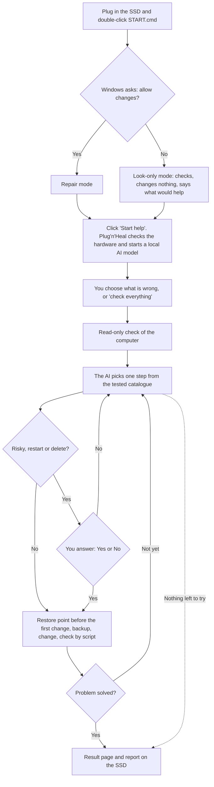

# Plug'n'Heal

**A free rescue SSD for Windows: plug it in, click one button, and a local AI fixes common problems. Offline.**

English | [Deutsch](README.de.md)

[](https://github.com/MisterDeeds/plug-n-heal/actions/workflows/ci.yml)
[](LICENSE)

> [!TIP]
> **TL;DR: a PC lost its network? One command, then one double-click.**
>
> 1. Plug an external SSD (exFAT or NTFS, 64 GB or more) into **any** Windows PC with internet.
> 2. Open PowerShell and paste:
>    ```powershell
>    irm -UseBasicParsing https://raw.githubusercontent.com/MisterDeeds/plug-n-heal/main/sync-drive.ps1 | iex
>    ```
> 3. Type the drive letter of the SSD. Done when it says `DONE`. It checks the drive first (format, free space,
>    write speed), then downloads what is missing (about 20 GB the first time, nothing on later runs).
> 4. Plug the SSD into the broken PC, double-click `AI\Start-Repair.cmd` (the command's last line shows the exact
>    path), answer **Yes**.
>
> The same command updates the drive later. Details and risks: [network rescue kit](#network-rescue-kit-one-command).

> [!IMPORTANT]
> **Status: version 0.1, early.** The code has automated tests (Pester) that run on Linux and Windows in CI,
> for Windows PowerShell 5.1 and PowerShell 7. On every change an **end-to-end test on Windows** (GitHub's
> Windows Server runner, Windows PowerShell 5.1, CPU only) builds a drive with the smallest model, stops the
> print service and checks that Plug'n'Heal finds and fixes it on its own (about one minute). Most repair steps
> have **not yet been tried on real home PCs** (see
> [docs/TOOLBOX.md](docs/TOOLBOX.md#11-what-still-needs-real-windows)). Please try it first on a computer that
> does not matter much, and [tell us how it went](https://github.com/MisterDeeds/plug-n-heal/issues/new/choose).

> [!CAUTION]
> **This program changes your computer.** An AI model chooses repair steps, and they run with administrator
> rights. AI can be wrong. Plug'n'Heal only uses steps from a fixed, reviewed list, backs up before every change,
> checks the result with a script and asks you before anything risky. Still: back up your photos and documents
> first, and do not use it on a computer from your employer or school.

## Contents

- [What it does](#what-it-does) · [How it works](#how-it-works) · [What you need](#what-you-need)
- [Build your Plug'n'Heal drive](#build-your-plugnheal-drive) · [Use it](#use-it) ·
  [Network rescue kit: one command](#network-rescue-kit-one-command)
- [Which AI model will my PC use?](#which-ai-model-will-my-pc-use)
- [Safety: what it never does](#safety-what-it-never-does) · [What can go wrong](#what-can-go-wrong) ·
  [Privacy](#privacy)
- [Troubleshooting](#troubleshooting) · [FAQ](#faq) · [For developers](#for-developers)
- [Licences](#licences) · [Disclaimer](#disclaimer) · [Credits](#credits)

## What it does

- **It looks first.** A fixed check reads the state of the computer: internet, free disk space, printer, sound,
  Windows Update, important settings and the event log. This check changes nothing.
- **A local AI picks the repair.** A language model runs on the SSD with [Ollama](https://ollama.com). It may
  only choose from a catalogue of 92 reviewed actions (61 of them change something). It does not get a free
  command line, except a filtered one for the largest models ([details](docs/SAFETY.md)).
- **Every change is backed up and checked.** Before the first change it tries to create a Windows restore
  point. Before each change it saves the old state. After each change a script, not the AI, checks whether it
  worked.
- **It asks you first** before risky steps, before a restart and before it deletes anything (it only deletes
  temporary files and caches, or a saved Wi-Fi network after keeping a copy).
- **It works offline and keeps everything on the SSD.** It needs no internet. Nothing is sent anywhere. A short
  report and a detailed log are written to the SSD.

## How it works



A run ends when the check passes, when the AI says it is done, after 12 rounds, after repeated errors, or when a
finding says that repairing here would be wrong (for example a computer that its company cut off from the
network). "Solved" is only shown when the check script passed.

## What you need

| For | You need |
|---|---|
| The computer with the problem | Windows 10 or Windows 11, 64-bit, on an Intel or AMD processor. At least 8 GB of memory (RAM); 16 GB is better. A USB 3 port is faster. Windows on ARM (for example Snapdragon laptops) has not been tested. |
| The drive | An external SSD, formatted with **exFAT**. 64 GB or more is recommended. A fast USB stick also works but loads the AI more slowly. |
| Building the drive (once) | Any PC with internet: Windows 10 or 11 (wizard), or Linux or macOS (command line). |

How much space each choice needs (model sizes are measured, see [docs/MODELS.md](docs/MODELS.md)):

| Choice in the builder | AI models | Total on the SSD (the builder shows) | SSD size | Download |
|---|---|---|---|---|
| Small | 2 small models, 5.3 GB | about 8.1 GB | 16 GB or more | about 6.9 GB |
| **Standard** (recommended) | 4 models, 29.6 GB | about 32.4 GB | 64 GB or more | about 31.2 GB |
| Full | 6 models, 62.6 GB | about 65.4 GB | 128 GB or more | about 64.2 GB |

"Total on the SSD" is models + the Ollama runtime (2.3 GB unpacked) + 0.5 GB that the builder keeps free.

## Build your Plug'n'Heal drive

You do this once, on a PC with internet. It is safe for the files already on the SSD: the builder only writes
the folder `PlugNHeal`, the file `START.cmd` and the file `README.txt`. It never formats a drive.

### On Windows

1. **Plug in the SSD.** It must be formatted with exFAT (or NTFS). New SSDs often are. If not, see
   [Format the SSD with exFAT](docs/BUILDING.md#2-format-the-ssd-with-exfat). Formatting erases the SSD.
2. **Download Plug'n'Heal.** Open <https://github.com/MisterDeeds/plug-n-heal>, click the green **Code** button,
   then **Download ZIP**. There are no release downloads yet.
3. **Unblock the ZIP.** Right-click the downloaded ZIP file, choose **Properties**. At the bottom, tick
   **Unblock** and click **OK**. If there is no such box, just continue.
   *Why:* Windows marks downloaded files. Without this step every unpacked file keeps the mark, and Windows shows
   security warnings or, with Smart App Control, blocks the builder.
4. **Unpack it.** Right-click the ZIP, choose **Extract All...**, then **Extract**. A folder opens.
5. **Start the builder.** In that folder, double-click **BUILD.cmd**. A black window and the builder window
   *"Plug'n'Heal – prepare the SSD"* open. Leave the black window open.
6. **Pick the SSD.** Under *"1. Which SSD should be prepared?"* click your SSD, then **Next**.
   Not in the list? Click **Refresh list**, or **Show all drives** for drives that Windows counts as internal.
7. **Pick the size.** Under *"2. How much should go onto the SSD?"* choose **Standard** unless your SSD is small.
   Then click **Build the SSD**.
8. **Wait.** The builder downloads the Ollama runtime and the AI models, checks every file and writes them to the
   SSD. With 100 Mbit/s internet, *Standard* takes roughly 45 minutes, *Full* about 1.5 hours. Keep the PC on and
   online; the builder keeps it awake. You can cancel at any time. Start `BUILD.cmd` again later and it
   continues where it stopped.
9. **Done.** When it says *"Done! The SSD is ready."*, eject the SSD in File Explorer (right-click, **Eject**)
   and unplug it.

### On Linux or macOS

You need `bash`, `curl` and `python3` (on macOS: `xcode-select --install`). Mount the SSD (exFAT), then:

```bash
git clone https://github.com/MisterDeeds/plug-n-heal.git
cd plug-n-heal
./builder/build-drive.sh /media/$USER/PLUGNHEAL standard   # Linux, adjust the path
./builder/build-drive.sh /Volumes/PLUGNHEAL standard       # macOS
```

The profile is `small`, `standard` (default) or `full`. Run the same command again after an interruption. The
script downloads the models straight from the Ollama registry and checks the SHA-256 of every file. It has not
yet been tested on macOS. More: [docs/BUILDING.md](docs/BUILDING.md).

## Use it

This part is for the person sitting at the computer that has the problem.

1. **Save your work and close your programs.** Some repairs need a restart.
2. **Plug the SSD into the computer.**
3. **Open the SSD.** Open File Explorer (the folder icon in the taskbar, or press the Windows key and E at the same
   time). Click the SSD on the left. It is often called *PLUGNHEAL*.
4. **Double-click `START.cmd`.** Windows may show it just as *START*. A small black window appears for a moment.
5. **Windows asks:** *"Do you want to allow this app to make changes to your device?"* (Windows PowerShell,
   publisher Microsoft Windows). Click **Yes**.
   If you click **No**, Plug'n'Heal only looks. It changes nothing and tells you at the end what would probably
   help.
6. **Click the big button "Start help".** Wait 1 to 2 minutes while it gets ready. You do not need to do
   anything.
7. **"What is not working?"** Click what fits best: the internet, a slow computer, a full disk, the printer, the
   sound, Windows updates, the screen. Not sure? Click **"I don't know – please check everything"**. For
   anything else, click **"Something else"** and write one sentence, for example *"The screen is very dark."*
8. **Answer the questions.** Before an important step a window asks *"May I do this?"* and explains it. Click
   **"Yes, do it"** or **"No"**. If you are unsure, click **No**. The answer "No" is respected: it will not try
   the same step again.
9. **Read the result.** It says *"Done! The problem is fixed."* or *"Sorry, I could not completely fix the
   problem."*, and lists what it did. **"Show report"** opens the report. If it says so, restart the computer.
10. **Click "Finish"**, then unplug the SSD.

You can stop at any time with **Cancel**. What is already done stays done.

The report (`summary.txt`) and the detailed log are on the SSD in `PlugNHeal\logs\<computer name>-<date and
time>\`. If the problem is not solved, show this report to someone who knows computers.

## Network rescue kit: one command

A second, more direct tool for one hard case: **a PC that has lost its network connection**. A local agent (the
Codex CLI with a large local model through Ollama) works on the PC with administrator rights, runs commands by
itself and keeps going in rounds until a network check passes. It shows live what it says and which command it runs.

> [!CAUTION]
> This agent has a real command line with administrator rights and does not ask before each step. It works under
> written rules, not inside a fixed catalogue like the app above. Read [kit/README.md](kit/README.md) first.

**Prepare or update the drive** on any Windows PC with internet. Plug in the SSD, open PowerShell and paste:

```powershell
irm -UseBasicParsing https://raw.githubusercontent.com/MisterDeeds/plug-n-heal/main/sync-drive.ps1 | iex
```

The command lists the drives and asks for the letter of your SSD. Then it does everything by itself:

- It always refreshes the small kit files (scripts and instructions) from this repository.
- It keeps what is already on the drive. The Ollama runtime (1.6 GB), the Codex CLI (0.2 GB) and the language model
  (`qwen3.8:27b`, 17.7 GB) are only downloaded when they are missing. An interrupted download resumes.
- Run it again any time to bring the drive up to date.

**Use it:** plug the SSD into the PC with the problem, open the drive, double-click `AI\Start-Repair.cmd` and answer
the Windows question with Yes. It stops when the network works, when a restart is needed, or when it is blocked and
explains why.

Needs Windows 10 or 11 (64-bit), an exFAT or NTFS drive with about 25 GB free and, for good speed, a graphics card
with 24 GB of memory. Status: the sync and the harness are tested on Windows; a real repair with the large model is
not proven yet. Details, parameters and limits: [kit/README.md](kit/README.md).

## Which AI model will my PC use?

Plug'n'Heal chooses automatically. It measures the graphics card memory (VRAM) and the RAM, picks the largest model
on the SSD that fits, loads it and measures its speed. If it is too slow (small models under 5 tokens per second, the
9B under 10, the 27B and the fast mode under 15), or a model meant for the graphics card does not fit almost
completely onto it, it tries the next smaller model.

| Your computer | Model it uses (if it is on the SSD) | On the SSD with |
|---|---|---|
| NVIDIA or AMD graphics card with 24 GB or more | Qwen3.8 27B, on the graphics card | Standard, Full |
| NVIDIA or AMD card with 16 or 20 GB, and 32 GB RAM | Qwen3.6 35B-A3B (fast mode), partly on the processor | Full |
| NVIDIA or AMD card with 16 or 20 GB, less RAM | Qwen3.5 9B in higher precision (Q8) | Full |
| NVIDIA or AMD card with 10 to 12 GB (or 16 to 20 GB with *Standard*) | Qwen3.5 9B | Standard, Full |
| NVIDIA or AMD card with 6 or 8 GB | Qwen3.5 4B | all |
| NVIDIA or AMD card with 4 or 5 GB | Qwen3.5 2B | all |
| No suitable card (Intel or built-in graphics, or a card under 4 GB), 12 GB RAM or more | Qwen3.5 4B, on the processor | all |
| No suitable card, 8 GB RAM | Qwen3.5 2B, on the processor | all |
| Less than 8 GB RAM | Qwen3.5 2B anyway, probably too slow | all |

The exact rule: usable VRAM = VRAM of the best dedicated NVIDIA or AMD card minus 1.5 GB; the model's `minVramGB`
must fit into it. Without such a card only the two small models are used, and the model's `minRamGB` must be at
most RAM minus 4 GB. Intel and built-in graphics are treated as "no card" for now. Details:
[docs/MODELS.md](docs/MODELS.md).

Small models are less reliable than large ones. Only the two largest models may propose their own (filtered)
PowerShell commands; the others can only use the catalogue.

## Safety: what it never does

- Delete your personal files. The only deleting steps remove old temporary files and caches, or forget a saved
  Wi-Fi network after saving a copy of it. They always ask first. Crash dumps and stuck print jobs are moved to
  the SSD, not deleted.
- Format, partition or wipe a disk, or change the boot configuration.
- Switch off or weaken Microsoft Defender, the firewall, SmartScreen, User Account Control or BitLocker.
- Lift a network isolation that a company set with Defender for Endpoint. It explains it and stops.
- Read BitLocker recovery keys or show passwords.
- Delete restore points or shadow copies.
- Create, change or delete user accounts or passwords.
- Install itself on the computer. No catalogue step installs programs or drivers.
- Send anything to the internet. The AI runs on the SSD and only listens on the computer itself (127.0.0.1).
- Run a command from its block list, even if you say "Yes".

How it decides, what it asks and where its limits are: [docs/SAFETY.md](docs/SAFETY.md).

## What can go wrong

| What can happen | What Plug'n'Heal does | What you can do |
|---|---|---|
| The AI misjudges the problem, the repair does not help | Only reviewed steps; success is checked by a script; "solved" only when the check passes | Show the report to someone who knows computers |
| The AI writes something wrong while it works (small models sometimes claim things they did not do) | Its live messages are marked as "not checked"; the result page is built only from checked results | Trust the result page, not the live messages |
| A repair has a side effect on your particular PC | Backup before each change; undo when the change fails; restore point before the first change | [System Restore](#if-something-got-worse-system-restore) |
| No restore point is created (System Protection off, Windows allows only one per 24 hours, ...) | Logs it and continues; each step has its own backup | Turn on System Protection before, if you want a fresh point |
| The steps behave differently on your PC than in the tests | They have not yet run on many real PCs | Try it on a less important PC first; report problems |
| Company or school PC, Smart App Control or S mode blocks it | A locked PowerShell is detected and explained; on managed PCs network, update and time settings are not touched | Ask whoever manages the PC |
| The company isolated the PC with Defender for Endpoint | Detected, explained, nothing changed; this cannot be lifted on the PC itself | Call the company's IT |
| It is very slow or says the computer is too slow | Picks a smaller model; measures the speed | Use another PC, plug a laptop into power |
| An antivirus program warns | Plain, readable scripts; no hidden code | Do not switch off the antivirus; [report it](https://github.com/MisterDeeds/plug-n-heal/issues) |
| Personal details end up in the log | Everything stays on the SSD | Delete the `logs` folder before giving the SSD away |

### If something got worse: System Restore

If Windows could create a restore point, you can go back to it: press the Windows key, type
**Create a restore point**, open it, click **System Restore...** and choose the point called
*"Plug'n'Heal: ..."*. Files like photos and documents are not affected by this. Microsoft's guide:
[Use System Restore](https://support.microsoft.com/en-us/windows/use-system-restore-a5ae3ed9-07c4-fd56-45ee-096777ecd14e).

Every change is also backed up in the run folder on the SSD (`backups\`). Undoing a single step from there is a
task for an expert (`Undo-PnhAction`, see [docs/TOOLBOX.md](docs/TOOLBOX.md)); there is no button for it yet.

## Privacy

- Plug'n'Heal works offline. It sends nothing, and the AI model runs on the SSD.
- Each run creates a folder on the SSD: `PlugNHeal\logs\<computer name>-<date and time>\`. It contains the report,
  the full check of the computer, the conversation with the AI and the backups. The builder also keeps its log
  there.
- These files contain details of the computer: its name, printer names, network settings, Windows event messages,
  user names in folder paths and the words you typed. Plug'n'Heal does not collect passwords on purpose, but some
  output can contain personal data.
- **Before you give the SSD to someone else, delete the folder `PlugNHeal\logs`.** (After that, the backups are
  gone too.)

## Troubleshooting

| What you see | What it means | What to do |
|---|---|---|
| *"Plug'n'Heal could not start ... probably blocks helper programs"* with a code | Windows did not let PowerShell run, usually on a company or school PC | Ask the person who manages the computer |
| *"The helper is not allowed to run here"* | PowerShell runs in a locked mode (company rules, possibly Smart App Control) | As above. Plug'n'Heal cannot work there |
| Nothing happens at all, or Windows says it cannot run this app, or *"This computer is in S mode"* | Windows in S mode allows only Store apps | Plug'n'Heal cannot run in S mode |
| *"Plug'n'Heal is incomplete: the folder PlugNHeal is missing"* | The SSD was not built, or files were deleted | Run the builder again |
| *"Without your permission I can only look"* | You clicked **No** at the Windows question | Start again and click **Yes**. A standard user needs an administrator password |
| *"The helper could not be started"* | The Ollama program on the SSD did not start | Try another USB port. If files are missing (for example removed by an antivirus), delete the folder `PlugNHeal\runtime` on the SSD and run the builder again |
| *"The helper is missing on the drive"* | No AI model on the SSD | Run the builder again |
| *"Sorry, this computer is too slow"* | Even the smallest model on the SSD was slower than 5 tokens per second | Close other programs, plug in a laptop, or use another PC |
| *"This computer does not have enough memory"* | The RAM is smaller than even the smallest model on the SSD needs (2B: 3 GB) | Use a PC with more memory |
| *"Plug'n'Heal is already open"* | A second start | Look for its window in the taskbar |
| The builder says *"This SSD is formatted with FAT32"* | FAT32 cannot hold files over 4 GB | [Format the SSD with exFAT](docs/BUILDING.md#2-format-the-ssd-with-exfat) |
| The builder says *"Not enough space on the SSD"* | The choice does not fit | Choose a smaller size or a larger SSD |
| The builder stopped (internet, sleep, cancel) | Downloads are kept | Start the builder again; it resumes |
| *"The size of ... does not match the model list"* | A model was changed on the Ollama server | Use a newer Plug'n'Heal version |

When asking for help, attach `summary.txt` and `run.log` from the run folder (remove personal details first).

## FAQ

**Does it need the internet?** No. Only building the SSD needs internet.

**Does it install anything on my computer?** No. It runs from the SSD and keeps its files there. The repairs
themselves change Windows settings, and Windows may create a restore point.

**Does it send my data anywhere?** No. See [Privacy](#privacy).

**How long does it take?** Getting ready takes 1 to 2 minutes. A repair usually takes a few minutes; on a slow
computer without a graphics card each step can take longer.

**Can I use one SSD on many computers?** Yes. Each run gets its own log folder named after the computer.

**Can I give a finished SSD to someone?** Yes, but delete `PlugNHeal\logs` first. The licences of the included
software are on the SSD in `PlugNHeal\licenses`. See [THIRD-PARTY-NOTICES.md](THIRD-PARTY-NOTICES.md).

**My antivirus or SmartScreen warns. Is it a virus?** Plug'n'Heal consists of readable PowerShell scripts and the
signed Ollama program. Do not switch off your protection. Unblock the ZIP before unpacking (step 3 of the
builder), and report false alarms.

**Can I choose the AI model?** The window chooses automatically. Experts can use `Run-Headless.ps1 -Model <tag>`
(see [For developers](#for-developers)).

**Does it work on Windows 7 or 8, or on a Mac?** No. It repairs Windows 10 and 11. A Mac or Linux PC can only
*build* the SSD.

**What if it made things worse?** See [System Restore](#if-something-got-worse-system-restore).

## For developers

| Path | Content |
|---|---|
| `BUILD.cmd`, `builder/` | Builder: Windows wizard `Build-Drive.ps1`, Linux/macOS `build-drive.sh`, pinned runtime `versions.json` |
| `src/` | Copied to the drive as `PlugNHeal\app\`: `START.cmd`, `Start.ps1`, `Ui.ps1` (WinForms), `Run-Headless.ps1` |
| `src/lib/` | `Common`, `Hardware`, `Models`, `Ollama`, `Diagnose`, `Toolbox`, `Agent` |
| `src/catalog/models.json` | Model ladder and profiles |
| `src/toolbox/` | `actions.json` (92 actions), `findings.json` (63 finding codes), `categories.json`, `helpers.ps1` |
| `src/i18n/`, `src/prompts/` | All user-visible text in German and English, system prompts |
| `tests/` | Pester 5 tests, run on Windows PowerShell 5.1 and PowerShell 7 |
| `docs/` | [ARCHITECTURE](docs/ARCHITECTURE.md), [SAFETY](docs/SAFETY.md), [TOOLBOX](docs/TOOLBOX.md), [MODELS](docs/MODELS.md), [BUILDING](docs/BUILDING.md), [TESTING](docs/TESTING.md), [research notes](docs/research/) (German) |

Run the tests:

```powershell
pwsh -NoProfile -File tests/Invoke-Tests.ps1      # or Windows PowerShell 5.1: powershell -File tests\Invoke-Tests.ps1
```

Try the window without changing anything (simulated work, no AI needed):

```powershell
powershell -NoProfile -ExecutionPolicy Bypass -STA -File .\src\Ui.ps1 -Demo
```

Run the whole flow without a window, for example on a test PC with a built drive:

```powershell
powershell -NoProfile -ExecutionPolicy Bypass -File X:\PlugNHeal\app\Run-Headless.ps1 -Category printer -AutoConfirm
```

- Add a repair action: [docs/TOOLBOX.md, "Adding an action safely"](docs/TOOLBOX.md#10-adding-an-action-safely).
- How to contribute, coding rules for Windows PowerShell 5.1: [CONTRIBUTING.md](CONTRIBUTING.md).
- Tests and the manual test checklist for real PCs: [docs/TESTING.md](docs/TESTING.md).
- Security problems: [SECURITY.md](SECURITY.md), please not in public issues.
- Changes: [CHANGELOG.md](CHANGELOG.md). Code of conduct: [CODE_OF_CONDUCT.md](CODE_OF_CONDUCT.md).

## Licences

- Plug'n'Heal itself (this repository) is licensed under the [Apache License 2.0](LICENSE). See also
  [NOTICE](NOTICE).
- This repository contains no third-party software and no AI models. The builder downloads them from their original
  sources: the Ollama runtime (MIT) with its bundled libraries, including llama.cpp/ggml (MIT), NVIDIA CUDA
  runtime libraries and Microsoft Visual C++ runtime files. They come with their own licences, listed in
  [THIRD-PARTY-NOTICES.md](THIRD-PARTY-NOTICES.md). The builder copies that list and the licence files that come
  with the downloads to `PlugNHeal\licenses` on the SSD.
- The AI models have their own licences. The default catalogue contains only Apache-2.0 models (Qwen3.5, Qwen3.6,
  Qwen3.8).

## Disclaimer

Plug'n'Heal is provided "as is", without any warranty. You use it at your own risk. As far as the law allows, the
authors are not liable for any damage, for example lost data or a computer that no longer starts. This is what
sections 7 and 8 of the [licence](LICENSE) say in plain words; the licence text is what counts.

Plug'n'Heal is not affiliated with or endorsed by Microsoft, Ollama, Alibaba Cloud (Qwen), NVIDIA or the ggml
authors.

## Credits

- [Ollama](https://ollama.com) runs the language models locally.
- [Qwen](https://github.com/QwenLM) (Alibaba Cloud) made the open models Qwen3.5, Qwen3.6 and Qwen3.8.
- [llama.cpp](https://github.com/ggml-org/llama.cpp) and [ggml](https://github.com/ggml-org/ggml) do the actual
  computing inside Ollama.
- [Pester](https://pester.dev) and
  [PSScriptAnalyzer](https://learn.microsoft.com/en-us/powershell/utility-modules/psscriptanalyzer/overview) test
  the code.
